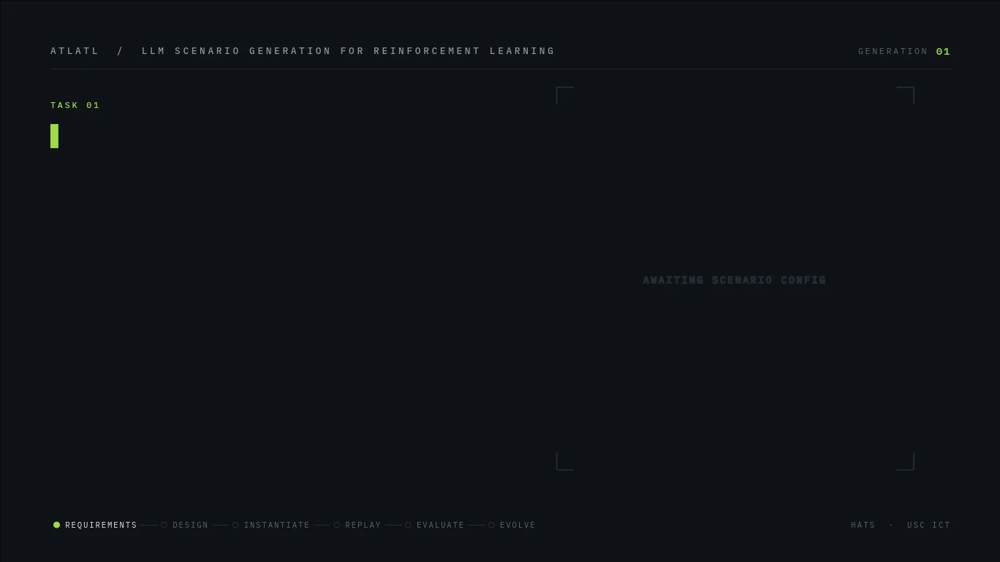
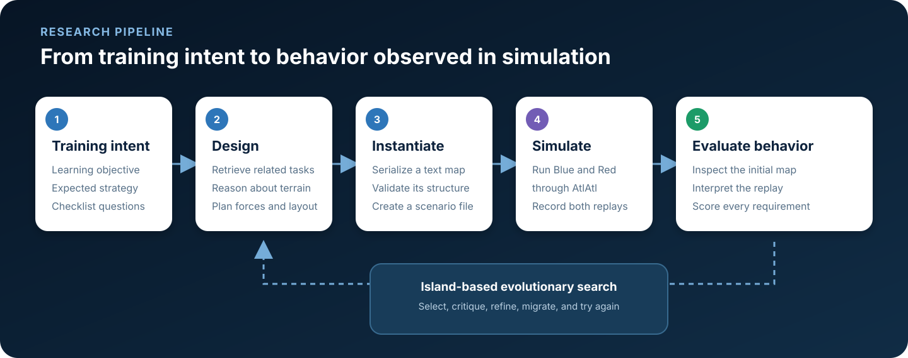

# AtlAtl Scenario Generation

### Evolving wargaming scenarios from training objectives

This research prototype turns a natural-language learning objective into an
executable tactical scenario, observes how agents behave when they play it, and
uses that evidence to search for better scenarios.

  

The project investigates a deceptively hard question:

> Can we generate a scenario that is not only valid, but actually elicits the
> tactical behavior a learner is supposed to practice?

The output is therefore more than a map. It is a map, a real gameplay replay,
and evidence that the resulting behavior aligns with the original training
intent.

## What the system does

A task begins with three pieces of information:

- a **learning objective** describing what an agent should practice;
- an **expected strategy** describing how that behavior should appear;
- **checklist questions** that can be answered from the initial map or the
  resulting replay.

The system retrieves two related examples from a library of six completed naval
scenarios, reasons about the required tactical geometry, and instantiates the
design as a structured textual hex map. After validating and converting the
map, it runs the scenario in AtlAtl with configured Blue and Red heuristics.
The replays are translated into a textual account and evaluated against the
task-specific checklist.

  

Candidate scores and textual feedback guide an island-based evolutionary
search. The process can select previous candidates as parents, critique their
failures, recombine their useful ideas, refine complete solutions, migrate
candidates between islands, and reset weaker populations around stronger
designs.

Three design choices make the loop practical: tactical reasoning is separated
from exact map serialization; maps are represented as inspectable text rather
than pixels; and scenario quality is evaluated from gameplay rather than map
validity alone. This allows a candidate to fail for behavioral reasons even
when its structure and terrain initially look plausible.

The evolutionary method is a domain-specific adaptation of Google DeepMind’s
**Mind Evolution**, introduced in
[*Evolving Deeper LLM Thinking*](https://deepmind.google/research/publications/122391/)
by Lee et al. Mind Evolution supplies the underlying population search,
islands, selection, recombination, evaluator feedback, and
Refinement-through-Critical-Conversation structure. This project applies that
method to a new domain in which candidates are tactical maps and evaluation
requires simulator replays. See the
[research background](docs/research-background.md#methodological-lineage) for
the detailed mapping to the original method and the
[paper](https://arxiv.org/abs/2501.09891).

## Results at a glance

The initial project study used six scenarios from
[*Optimizing Naval Movement Using Deep Reinforcement Learning*](https://doi.org/10.1109/ICMLA58977.2023.00062)
as its example library, then tested two new objectives:

| New objective | Valid responses found |
| --- | --- |
| Fight a defensive enemy beyond a narrow channel | 3 within 2 generations |
| Attack across a narrow land boundary | 2 within 7 generations |

A later end-to-end run of the attack-across-land task used a local model served
through a llama.cpp endpoint. It simulated 11 candidates and stopped after the
third candidate received a 4/4 checklist score:

| Checklist score | Candidates |
| --- | ---: |
| 4/4 | 3 |
| 3/4 | 7 |
| 2/4 | 1 |

These are small pilot studies rather than benchmark results. They demonstrate
the complete loop: describe a learning objective, generate executable maps,
observe real agent behavior, and feed the observed successes and failures back
into scenario search.

## Read more

| Document | Contents |
| --- | --- |
| [Research background and methodology](docs/research-background.md) | DeepMind lineage, task formulation, textual map representation, simulator evaluation, worked examples, actual evolution trace, and pilot evidence |
| [Running experiments](docs/running-experiments.md) | Installation with an authorized AtlAtl checkout, model providers, configuration, commands, and outputs |
| [Six reference examples](scenario_generation/mind_evolution/examples/examples.json) | Learning objectives, expected strategies, completed maps, and evaluation records used for retrieval |

## Repository contents

This repository contains the generation, conversion, replay-analysis,
evaluation, and evolutionary-search code. It supports both OpenAI models and
local text models exposed through llama.cpp’s OpenAI-compatible API.

It does **not** contain AtlAtl, its browser interface, or its simulator source.
Executing a full experiment requires a separately obtained, authorized AtlAtl
installation. The media on this page was exported from authorized real runs;
the simulator implementation is not distributed here.

With access, clone `atlatl_ICT` next to this repository and run `uv sync`; see
[Running experiments](docs/running-experiments.md).
