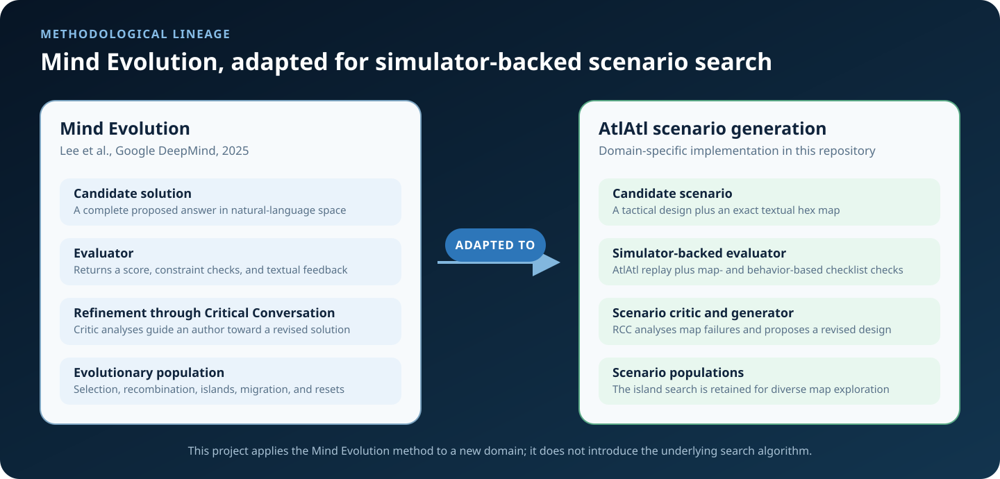
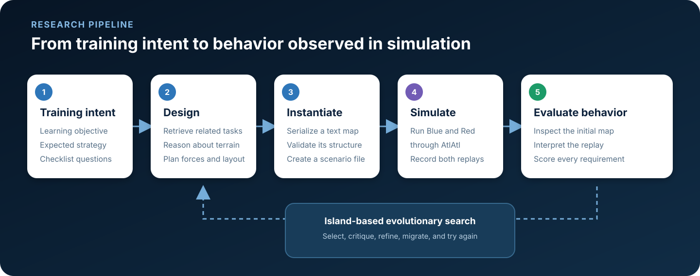
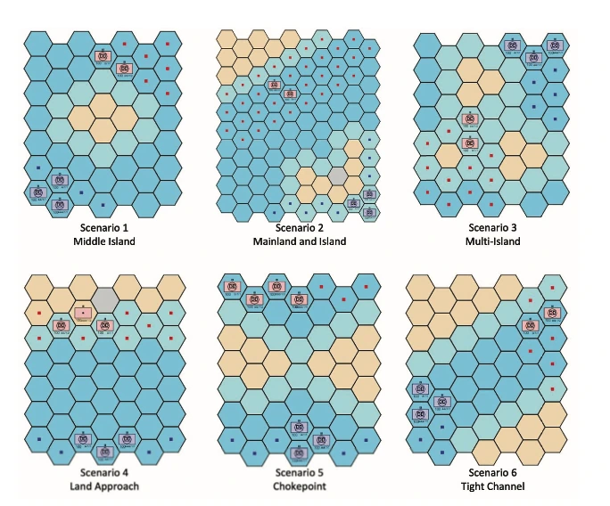
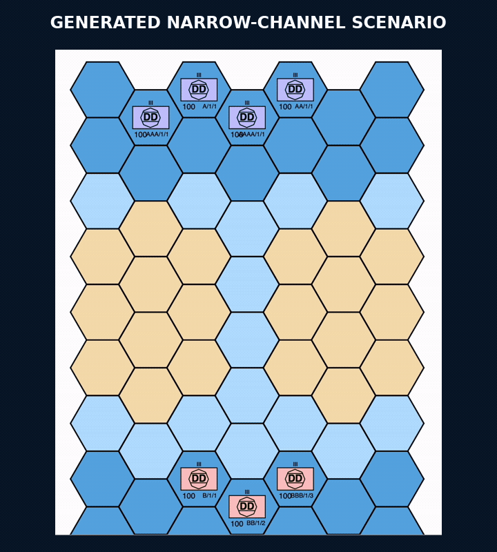
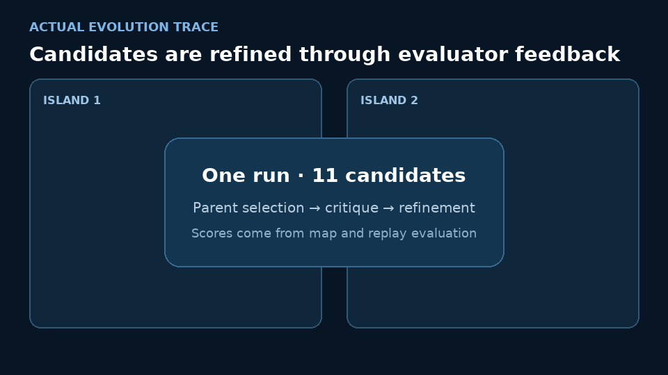
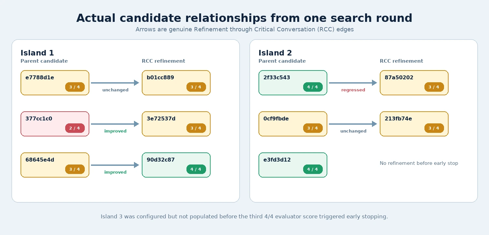

# Research background and methodology

## Overview

This project explores automated scenario design for reinforcement-learning and
wargaming research. Given a learning objective and a description of the desired
tactical behavior, it generates a playable hex-map scenario, executes that
scenario in AtlAtl, evaluates the initial geometry and resulting gameplay, and
uses the feedback to search for stronger designs.

The central distinction is between a map that is merely executable and a
scenario that creates the intended learning opportunity. A syntactically valid
map can still be strategically irrelevant: units may never meet, terrain may
permit an unintended shortcut, or the configured policy may respond in a way
that defeats the lesson. Evaluating the replay makes behavior part of the
scenario-design objective.

## Methodological lineage

The evolutionary-search framework in this repository derives heavily from
Google DeepMind's **Mind Evolution**, introduced by Kuang-Huei Lee, Ian Fischer,
Yueh-Hua Wu, Dave Marwood, Shumeet Baluja, Dale Schuurmans, and Xinyun Chen in
[*Evolving Deeper LLM Thinking*](https://deepmind.google/research/publications/122391/)
([arXiv:2501.09891](https://arxiv.org/abs/2501.09891)).

This project does **not** introduce the underlying Mind Evolution algorithm. It
adapts that method from natural-language planning to tactical scenario
generation. The key inherited idea is to search both broadly and deeply:
maintain diverse populations of complete candidate solutions, evaluate them,
then ask an LLM to critique and refine promising candidates using the
evaluator's feedback.

<p align="center">
  
</p>

The main correspondence is:

| Mind Evolution | Scenario-generation adaptation |
| --- | --- |
| Complete solution in natural-language space | High-level tactical design plus a serialized hex map |
| Task-specific candidate evaluator | AtlAtl simulation followed by map- and replay-based checklist evaluation |
| Numerical score, constraint checks, and textual feedback | Checklist score, map analysis, replay analysis, and per-question reasoning |
| Refinement through Critical Conversation (RCC) | A scenario critic analyses parent maps and an author proposes a revised scenario |
| Parent selection and recombination | Score-weighted sampling of zero or more previous scenarios |
| Multiple islands preserve diverse alternatives | Independent scenario populations explore different map designs |
| Candidate migration and island resets | Strong scenarios migrate between islands and seed replacement populations |
| Few-shot planning examples | Two relevant examples selected from a six-scenario naval library |

The domain changes the meaning of a candidate and, more importantly, the
evaluation process. Mind Evolution was demonstrated on planning tasks with
programmatic evaluators. Here, a candidate must first become an executable
scenario and produce a gameplay replay. The global evaluator combines evidence
from that initial state and observed behavior; the resulting text becomes input
to the next critical conversation.

## Defining a scenario-design task

A task contains three elements:

1. **Learning objective** — what an agent should learn or practice.
2. **Expected strategy** — the observable tactical behavior the map should
   encourage.
3. **Checklist questions** — conditions that make the requirement evaluable.

Checklist questions are marked as either initial-state-based or replay-based.
For example, whether a channel is bounded by land can be inspected before play,
while whether Blue remained grouped must be inferred from the replay.

One research task was:

> **Learning objective:** Learn to fight a defensive enemy on the other side of
> a narrow channel.
>
> **Expected strategy:** Blue forces travel closely along the channel and
> attack the defensive Red forces together.

Its checklist asked:

- Does the initial map contain a narrow navigable channel bounded by land?
- Did Blue travel through the channel as a close group?
- Did Blue perform coordinated attacks within the required turn window?

This formulation makes scenario quality observable without reducing it to a
single victory condition. Winning may not demonstrate the intended lesson, and
losing may still exhibit the behavior the scenario was designed to exercise.

## Generation and evaluation pipeline

The implementation separates tactical reasoning from exact map construction.
The first stage proposes a high-level design: terrain topology, force
composition, unit placement, engagement ranges, and the behavioral pressure the
map is intended to create. The second stage instantiates that design as a
structured hex grid.

The complete flow is:

1. Select two relevant completed examples using the new objective and expected
   strategy.
2. Generate a high-level scenario concept and exact textual map.
3. Validate row structure, terrain tokens, unit tokens, and map edges.
4. Convert the text map into an AtlAtl scenario file.
5. Run Blue and Red policies in the separately installed simulator.
6. Translate both replay logs into a textual description of the battle.
7. Answer the task-specific map and replay questions.
8. Return the score and textual analyses to the evolutionary search.

<p align="center">
  
</p>

Because evaluation occurs on complete scenarios, the search performs global
refinement rather than assigning rewards to individual reasoning steps. A
critic compares parent solutions, their maps, and their evaluation feedback.
An author then produces one revised complete map using the critic's analysis.

## Textual map representation

Maps are represented as staggered rows of compact tokens rather than images:

```text
w             s             r             s
      w             s             r
w100db        s             r             s100dr
      w             s             r
```

The first character encodes terrain:

| Token | Terrain |
| --- | --- |
| `w` | Deep water |
| `s` | Coast or shore |
| `r` | Rough land |
| `c` | Clear |
| `u` | Urban |
| `m` | Marsh |

An optional suffix encodes unit strength, type, and faction. For example,
`100db` is a strength-100 Blue destroyer and `100dr` is the corresponding Red
unit.

This representation exposes exact cells, adjacency, terrain, and forces in the
model context. It can also be parsed and structurally validated before invoking
the simulator. The model still has to reason about hex geometry and movement
rules, but it does not need to infer symbolic state from pixels.

## The six-scenario example library

The initial library comes from the six naval scenarios described in
[*Optimizing Naval Movement Using Deep Reinforcement Learning*](https://doi.org/10.1109/ICMLA58977.2023.00062):

<p align="center">
  
</p>

The library contains the learning objective, expected strategy, completed map,
and evaluation record for each scenario. For a new task, an LLM selects the two
most related examples. They serve as design priors and formatting examples;
the generator is instructed to solve the new objective rather than reproduce a
reference map.

## Worked example: coordinated channel transit

For the narrow-channel objective, the high-level design proposed:

- a continuous land belt split by a one-hex-wide littoral channel;
- slower shore cells inside the channel to encourage a compact advance;
- open water where Blue could assemble before entering the constriction;
- Red forces beyond the exit, creating a defended kill zone that punishes
  piecemeal emergence.

That concept became the playable scenario below. Blue enters the constriction,
forms a column, and eventually conducts same-turn coordinated attacks against
Red.

<p align="center">
  
</p>

| Requirement | Evidence | Result |
| --- | --- | --- |
| A narrow navigable channel is bounded by land | Initial map | Passed |
| Blue travels through the channel as a close group | Gameplay replay | Passed |
| Blue performs coordinated attacks within the turn window | Gameplay replay | Passed |

The replay is essential evidence. A static map can indicate that a formation is
possible, but it cannot show whether the configured policy actually adopts that
formation during play.

## Evolution in a recorded run

The animation below is built from the stored `evolution_graph.json`. Unlike a
sequence of merely chronological examples, every arrow represents an actual
parent-to-RCC relationship recorded by the search.

<p align="center">
  
</p>

<p align="center">
  
</p>

This run demonstrates that refinement is not monotonic. One 2/4 candidate
improved to 3/4 and one 3/4 candidate improved to 4/4, but another 4/4 parent
produced a 3/4 refinement. Diversity remains useful because a critic-guided
revision can discard a working property as well as repair a failure.

The run was configured for three islands. It stopped after the evaluator
identified a third 4/4 candidate, before the third island was populated. In
total, it simulated 11 candidates:

| Checklist score | Candidates |
| --- | ---: |
| 4/4 | 3 |
| 3/4 | 7 |
| 2/4 | 1 |

The earlier two-task study reported three valid narrow-channel responses within
two generations and two valid attack-across-land responses within seven
generations.

## Limitations

These experiments cover a small number of objectives and should be treated as
pilot evidence rather than a benchmark. Checklist answers that rely on an LLM
can be inconsistent, particularly when long replay traces interact with terrain
and movement rules. Scenario quality is also policy-dependent: a map that
elicits the intended behavior from one heuristic may not do so from another.
Generated candidates therefore remain appropriate for human review, and
initial-state properties that can be calculated directly are good candidates
for deterministic evaluation.

Full simulation additionally requires a separately authorized AtlAtl
installation. AtlAtl source and browser code are not distributed in this
repository.

## References

- Kuang-Huei Lee, Ian Fischer, Yueh-Hua Wu, Dave Marwood, Shumeet Baluja, Dale
  Schuurmans, and Xinyun Chen. “Evolving Deeper LLM Thinking.” Google DeepMind,
  2025. [Official publication page](https://deepmind.google/research/publications/122391/),
  [arXiv:2501.09891](https://arxiv.org/abs/2501.09891).
- Joseph Coble, Armon Barton, Chris Darken, and Scotty Black. “Optimizing Naval
  Movement Using Deep Reinforcement Learning.” ICMLA 2023.
  [DOI: 10.1109/ICMLA58977.2023.00062](https://doi.org/10.1109/ICMLA58977.2023.00062).

Implementation and configuration details are documented separately in
[Running experiments](running-experiments.md).
